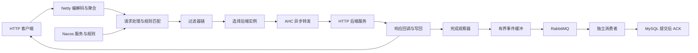

<div align="center">

# AegisFlow

**把服务发现、请求转发与访问记录串成可观察的链路。**

基于 Java 17、Netty 与 Nacos 的微服务接入网关，支持异步 HTTP 转发与可选访问事件流水。


</div>

## 项目做什么

客户端向网关发送 HTTP 请求，网关根据服务标识和动态规则组织过滤器链，选择可用后端实例，再通过 AsyncHttpClient 异步转发并回写结果。请求完成后，可以将访问事件交给 RabbitMQ 和独立消费者，异步保存到 MySQL。

| 能力 | 对应实现 |
| --- | --- |
| HTTP 统一接入 | [Netty 服务端](AegisFlow-Core/src/main/java/io/aegisflow/core/netty/NettyHttpServer.java)组织编解码、请求聚合和处理入口 |
| 服务发现与动态路由 | Nacos 维护实例与配置；[配置管理器](AegisFlow-Core/src/main/java/io/aegisflow/core/DynamicConfigManager.java)维护本地缓存及规则索引快照 |
| 策略组合 | [过滤器链工厂](AegisFlow-Core/src/main/java/io/aegisflow/core/filter/GatewayFilterChainChainFactory.java)通过 Java SPI 组织路由、负载均衡及可选鉴权、Mock、灰度和限流策略 |
| 请求可靠性 | [路由状态机](AegisFlow-Core/src/main/java/io/aegisflow/core/filter/router/RoutingExchange.java)管理总预算、有限 GET/HEAD 重试和断连取消；不自动重试 POST |
| 过载保护与停机 | [并发许可](AegisFlow-Core/src/main/java/io/aegisflow/core/monitor/AdmissionLimiter.java)限制本机服务在途请求；[生命周期管理](AegisFlow-Core/src/main/java/io/aegisflow/core/Container.java)停止接收并有限等待已有工作 |
| 异步访问记录 | [发布器](AegisFlow-Access/src/main/java/io/aegisflow/access/AccessPublisher.java)使用有界缓冲和发布确认；[消费者](AegisFlow-Access-Consumer/src/main/java/io/aegisflow/access/consumer/AccessConsumer.java)提交数据库事务后确认消息 |
| 可观测性 | [请求观察器](AegisFlow-Core/src/main/java/io/aegisflow/core/monitor/GatewayMetrics.java)记录关联 ID、延迟、状态、在途数和事件缓冲指标 |

> 本仓库面向学习与本地演示，不代表经过生产认证。访问事件可能因缓冲溢出、发布失败或强制退出而丢失；HTTP 成功不等于事件已经落库。

## 工作方式



访问记录是后台支线，不在业务响应链中同步等待数据库。停止时先关闭接收闸门，给在途请求有限时间完成，再注销实例、关闭连接和释放资源。

## 本地运行

**需要：** JDK 17、Maven 3.8+、Nacos 和演示 HTTP 后端。Redis 用于相关限流策略；启用事件流水还需 RabbitMQ、MySQL。首次获取 Maven 依赖需要联网，仓库不附带实际凭据。

1. 克隆仓库，在根目录构建与测试：

   ```bash
   mvn clean test
   mvn install
   ```

   单元测试不要求启动真实中间件。Maven groupId 为 io.aegisflow，根 artifactId 为 AegisFlow。

2. 启动你自己的 Nacos，默认配置地址为 127.0.0.1:8848。在配置中心发布根目录的 [api-gateway.json](api-gateway.json)：
   - Data ID：api-gateway
   - Group：与网关 env 相同，默认 dev

3. 将 Maven 项目导入 IDE，启动 HTTP 后端：
   - 模块：AegisFlow-Http
   - 主类：io.aegisflow.httpserver.Application
   - 后端的 api.registerAddress、api.env 需要与网关环境一致。

4. 启动网关：
   - 模块：AegisFlow-Core
   - 主类：io.aegisflow.core.Bootstrap
   - 默认入口端口：8888
   - 按需要修改 [gateway.properties](AegisFlow-Core/src/main/resources/gateway.properties)或启动参数，例如 --env=dev --port=8888。

也可通过 java 启动，运行 classpath 需包含该模块及其依赖。SPI 服务描述文件与 Spring 自动配置均已同步到 io.aegisflow 包名。

### 可选：开启访问事件流水

创建自己的 MySQL 数据库，默认名称为 aegisflow_access，执行 [schema.sql](AegisFlow-Access-Consumer/src/main/resources/schema.sql)，并配置进程环境变量：

| 配置项 | 用途 |
| --- | --- |
| AEGIS_RABBIT_USER | RabbitMQ 用户名，开启流水时必填 |
| AEGIS_RABBIT_PASSWORD | RabbitMQ 密码，开启流水时必填 |
| AEGIS_RABBIT_HOST | 消费者 RabbitMQ 地址，默认回环地址 |
| AEGIS_DB_URL | 消费者 JDBC URL，默认回环地址、3306端口及 aegisflow_access 数据库 |
| AEGIS_DB_USER | 消费者数据库用户名，必填 |
| AEGIS_DB_PASSWORD | 消费者数据库密码，必填 |
| AEGIS_JWT_SECRET | JWT 示例鉴权需要的 Base64 编码签名密钥，应自行随机生成 |

网关事件流水默认关闭，开启参数为 --accessEventsEnabled=true；网关 RabbitMQ 地址与端口由 --rabbitHost=...、--rabbitPort=... 覆盖。

消费者主类为 io.aegisflow.access.consumer.ConsumerMain，位于 AegisFlow-Access-Consumer。支持 JVM 属性 access.dbUrl、access.dbUser、access.dbPassword、access.rabbitHost、access.rabbitPort、access.rabbitUser 和 access.rabbitPassword 覆盖。

JWT 示例通过 aegisflow-jwt Cookie 获取 Token，不是完整登录与权限系统。请通过 IDE 或运行环境设置凭据，不提交到仓库，也不要写入会保存历史的明文命令；本项目不会自动加载 .env。

## 试一个请求

后端已注册、网关与规则就绪后：

```bash
curl -H "uniqueId: backend-http-server:1.0.0" http://127.0.0.1:8888/http-server/ping
```

当前实现通过 uniqueId 请求头识别服务和版本；直接在浏览器打开 URL 而不带请求头，不是等价调用。服务标识与 Nacos Data ID 在本次命名重构中保持不变，减少业务配置迁移成本。

常用指标入口：

- 网关：http://127.0.0.1:18000/prometheus
- 消费者统计：http://127.0.0.1:8094/stats
- 消费者指标：http://127.0.0.1:8094/prometheus

这些本地演示端点没有认证，默认绑定回环地址，不应直接暴露到公共网络。

## 目录导航

```text
AegisFlow-Core/             接入、策略、路由、指标与生命周期
AegisFlow-Common/           公共配置对象与工具
AegisFlow-Client/           后端注解扫描与注册集成
AegisFlow-Register-Center/  注册中心接口和 Nacos 实现
AegisFlow-Config-Center/    配置中心接口和 Nacos 实现
AegisFlow-Http/             Spring Boot HTTP 演示后端
AegisFlow-Access/           事件格式与 RabbitMQ 发布
AegisFlow-Access-Consumer/  消费、JDBC 写入与统计
AegisFlow-Dubbo/            原有 Dubbo 示例模块
AegisRPC-*/                 原有实验性 RPC 模块
```

Java 根包统一为 io.aegisflow，RPC 中带旧品牌前缀的控制器改为 AegisRpcController。仓库只保留代码、测试、必要配置与本 README，不包含个人文件、学习材料、截图、日志和本机压测结果。

## 已知边界

- 事件主键实现写入幂等，不是全链路 exactly-once；内存缓冲、有限重试与 classic 死信转发仍有丢失边界。
- 规则校验覆盖基础结构，未覆盖全部策略语义；Filter 组合变更时的缓存失效需完善，旧规则只在内存。
- 在途许可是单网关本机限制，不是全局集群配额。
- 停机等待预算不是整个 JVM 的硬退出时限，强杀或任意阻塞代码不保证清理完成。
- Dubbo/RPC 示例未获得与 HTTP 主链路等价的集成验证；依赖升级与生产安全加固仍是独立工作。
- 不宣称稳定最大 QPS，性能需要结合硬件、负载、启用功能、尾延迟与后台正确性验证。

## 来源与致谢

AegisFlow 基于公开项目 [BlossomGateway](https://github.com/ZhangBlossom/BlossomGateway)进行学习与工程化扩展，涉及请求可靠性、过载保护、访问事件、规则更新和生命周期验证。感谢上游项目提供的基础实现。

命名重构不改变原有代码来源，不把保留的基础实现宣称为完全原创。准备时未找到明确的上游再分发许可证，本仓库不擅自为上游代码授予新许可；使用者应自行核实适用权限。致谢不能替代授权。
